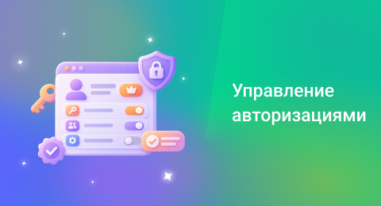

## Управление авторизациями

 
 

 
 

Раздел позволяет просматривать активные сессии сотрудников в личном кабинете UIS и при необходимости завершать их. Это помогает контролировать доступ к аккаунту и предотвращать несанкционированные действия, например, если сотрудник уволился или его учетная запись была скомпрометирована.

 

По умолчанию раздел доступен пользователям с ролями «СуперАдмин» и «Администратор». Для других ролей доступ можно настроить через права пользователей.

 
 

### **Просмотр авторизаций**

 

В разделе отображается таблица активных сессий сотрудников со следующими данными:

 

- **Сотрудник** — имя сотрудника, выполнившего вход;
- **Логин** — учетная запись, под которой выполнен вход;
- **IP-адрес** — адрес устройства, с которого выполнен вход;
- **Оператор** — интернет-провайдер устройства;
- **User Agent** — информация о браузере и операционной системе устройства;
- **Дата и время** — дата и время начала сессии;
- **Длительность сессии** — время, прошедшее с момента авторизации.

 
 

По умолчанию авторизации отсортированы по дате и времени: сначала отображаются последние входы. Чтобы изменить порядок отображения, нажмите на заголовок нужного столбца таблицы. Чтобы найти нужную сессию, используйте строку поиска. Поиск доступен по имени сотрудника, логину, IP-адресу и User Agent.

 
 

### **Завершение сессий**

 

Завершить сессию можно одним из двух способов:

 

- **Одну сессию** — найдите нужную авторизацию в таблице и нажмите на значок выхода в правой части строки.
- **Несколько сессий** — отметьте нужные авторизации флажками слева и нажмите «Выйти с выбранных устройств» в верхней части таблицы.

 

После завершения сессии сотрудник выйдет из личного кабинета UIS на соответствующем устройстве. Для повторного доступа потребуется снова авторизоваться.

 
 

### **Настройка уведомлений о входах**

 

Чтобы получать уведомления об авторизациях сотрудников:

 

1. Нажмите «Настроить уведомления о входах» в правом верхнем углу раздела;
2. Выберите событие «Авторизация в системе»;
3. Укажите способ получения уведомлений, например Email или SMS;
4. Сохраните настройки.

 

Уведомления помогут своевременно узнавать о новых входах в систему и выявлять подозрительную активность.

 
 

### **Управление собственными сессиями**

 

Каждый сотрудник может самостоятельно просматривать и завершать свои сессии в разделе <a href="/account/profile">«Мой профиль»</a>.
Текущая сессия выделена в списке. Можно завершить отдельные сессии на других устройствах или нажать «Сбросить все», чтобы завершить все сессии, кроме текущей.

 
 
 
 
 
 
 
 
 

