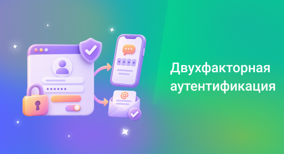

## Двухфакторная аутентификация

 
 

 
 

Раздел позволяет настроить дополнительную защиту при входе сотрудников в личный кабинет UIS. После ввода логина и пароля сотрудник должен подтвердить вход кодом, полученным по Email или SMS. Это помогает защитить аккаунт от несанкционированного доступа, даже если пароль стал известен посторонним.

 
 

### **Настройка двухфакторной аутентификации**

 
 

В блоке **«Канал для подтверждения входа»** выберите способ получения кода:
- **Email** — код поступит на электронную почту сотрудника.
- **SMS-сообщение** — код поступит на личный номер телефона сотрудника.

 

В блоке **«Для кого использовать»** выберите, для каких сотрудников будет действовать двухфакторная аутентификация:
- **Для всех пользователей** — подтверждение входа обязательно для всех сотрудников.
- **Для выбранных пользователей** — укажите сотрудников, которым потребуется подтверждать вход.
- **Для всех пользователей, кроме** — укажите сотрудников, которым не потребуется подтверждать вход.

 
 

<Alert type="info">Для входа с двухфакторной аутентификацией у сотрудника должен быть указан Email или личный номер телефона в зависимости от выбранного канала подтверждения. Иначе сотрудник не сможет войти в личный кабинет.</Alert>

 
 

Если у сотрудников не указаны необходимые контактные данные, появится уведомление со ссылкой на раздел «Сотрудники», где их можно заполнить.

 
 

### **Отключение двухфакторной аутентификации**

 

Чтобы отключить двухфакторную аутентификацию для отдельных сотрудников, выберите **«Для выбранных пользователей»** и удалите их из списка либо выберите **«Для всех пользователей, кроме»** и добавьте их в список исключений.

 

**Для администраторов отключение двухфакторной аутентификации недоступно** в целях безопасности.

 

Если **для доступа к разделам сотрудникам необходима двухфакторная аутентификация**, при ее отключении появится предупреждение. В предупреждении будут указаны сотрудники и разделы, к которым они потеряют доступ.

 
 

<Alert type="info">Отключение двухфакторной аутентификации не изменяет роли и права сотрудников, но ограничивает доступ к разделам, для которых она обязательна. Чтобы восстановить доступ, необходимо снова включить подтверждение входа.</Alert>

 
 
 
 
 
 
 
 
 
 

