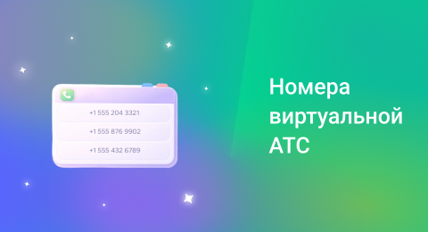

## Подключение номеров

 
 

 
 

### **Покупка номера UIS**

 

Вы можете зарезервировать номера для покупки во вкладке **«Купить номер»**. Для покупки доступны городские и мобильные номера, а также номера 8800.

 

Номера **Виртуальной АТС** нужны для голосовой связи: приема и совершения вызовов, настройки сценариев и маршрутизации входящих звонков.

 

Выберите префикс номера (код регион или города) и его категорию — обычный, бронзовый, серебряный и т. д. Категория определяет красоту номера, наличие в нем повторяющихся цифр и чисел. Снизу под выбранными параметрами номера отобразится стоимость его подключения.

 

За каждым номером нужно закрепить Конечного пользователя — это необходимо для соблюдения требований законодательства. Конечным пользователем может быть сотрудник организации или исполнитель по договору ГПХ. Это человек, который отвечает за использование номера, и его данные указываются для соблюдения правил оказания услуг телефонной связи. 

 
 

<Alert type="info">Больше информации можно узнать в разделе <a href="/b/account/responsible-user">Конечные пользователи</a></Alert>

 
 

Также вы можете привязать номер к **оборудованию M2M** (Machine-to-Machine). Это возможность закреплять за номером оборудование (терминалы для оплаты, онлайн-кассы и другие) без привязки к конкретному человеку. 

 

В этом случае после подключения номера потребуется передать данные о номерах через портал Госуслуг.

 
 

### **Подключение стороннего номера**

 

Вы можете подключить к нашему сервису собственные номера через вкладку **«Подключить сторонний номер».** Можно подключить номера с кодом РФ – как мобильные, так и городские. Для подключения номеров с зарубежным кодом обратитесь к своему менеджеру. 

 

Добавляемый сторонний номер должен обладать технической возможностью пропускать звонки по SIP-протоколу: заранее уточните это у оператора номера. Для подключения номера нужно ввести логин, имя сервера, порт и пароль. Логин и пароль для настройки SIP-линии можно узнать в личном кабинете или поддержке стороннего оператора. 

 

Исходящие звонки при этом оплачиваются по тарифам стороннего оператора.

 
 